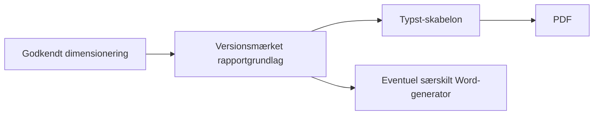

# Typst som rapportmotor

29. september 2026. Beslutningsgrundlag og afgrænset prototype; intet rapportdesign, arkitekturvalg eller bortfald af Word er godkendt.

## Vurdering

**Typst er en god kandidat, hvis PDF skal være det primære rapportformat.** TypeScript kan sende rapportens data til en fast Typst-skabelon, som styrer sideopsætning, tekst, tabeller, figurer og sidenumre og producerer PDF direkte. Der er dermed ikke behov for Word eller LibreOffice i denne eksportvej. Typst er en særskilt dokumentmotor med sit eget skabelonsprog; appen og beregningsmotoren kan stadig være TypeScript.

Typsts compiler kan køre lokalt eller på egen server. Den er open source under Apache-2.0, og en konto i den separate webeditor er ikke nødvendig for denne integration. [Officielt projekt](https://github.com/typst/typst). Data kan indlæses fra JSON, hvilket passer til et fælles rapportgrundlag. [JSON-dokumentation](https://typst.app/docs/reference/data-loading/json/).

Anbefalet retning til videre afprøvning:

Rapportgrundlaget skal indeholde præcis de valgte resultater, indstillinger, enheder, tekster og figurer. PDF-motoren må ikke genberegne dimensioneringen. Den gamle app er stadig den faglige reference.

## PDF til Word er en usikker reservevej

Det er muligt at åbne en PDF i Word, men Word genskaber afsnit, tabeller og anden struktur ud fra PDF'en. Microsoft oplyser, at konverteringen virker bedst ved overvejende tekst, og at blandt andet visse tabeller og grafiktunge sider kan ændre sig eller blive til billeder. Det er derfor ikke en sikker måde at bevare en fuldt redigerbar ingeniørrapport med samme layout. [Microsoft](https://support.microsoft.com/en-us/word/opening-pdfs-in-word).

Typsts dokumenterede direkte eksportformater omfatter PDF, PNG, SVG og HTML; DOCX er ikke en direkte eksportvej. [Typst-reference](https://typst.app/docs/reference/). Hvis Word senere bliver nødvendigt, anbefales det at generere dokumentet fra de bevarede rapportdata. Word/PDF vil da have fælles indhold, men hver sit layout, som skal kontrolleres.

## Gennemført afprøvning

En lokal TypeScript-prototype kalder Typst 0.15.1 og bruger den eksisterende rapports indhold. Ti inputcases er registreret fra den uændrede gamle rapports faktiske skabelondata: Standard, to geonetlag, NX850, trafikklasse, tre materialelag, manuel friktionsvinkel, cm, tomme tekstafsnit, fravalgt beregningsgrundlag og lange tekster.

| Kontrol | Resultat |
| --- | --- |
| Dynamiske tekster og tabelværdier i PDF | Alle forventede strenge genfundet i begge motorers ti PDF'er efter dokumenteret normalisering |
| Billeder i Standard-eksemplet | Begge Typst-billeder indeholder de samme afkodede RGB-pixels som input |
| Grundlag fravalgt | Overskrift/tabel udeladt i begge motorer |
| Tomme brugerredigerede tekster | Forbliver tomme; standardtekst indsættes ikke igen |
| Gentagelighed og samtidige job | To ens inputs giver samme PDF-hash; ændret projekttekst giver anden hash; separate jobmapper |
| Fem tests af TypeScript-prototypen | Bestået |
| Standard-eksemplets visuelle kontrol | Alle tre sider i begge motorer gennemgået; forskellige afstande, sidehoved/-fod og sideskift registreret |
| LibreOffice | Ikke afprøvet; baseline-PDF er dannet med den gamle lokale Word-vej |

Referencecases ligger i `reference/report-contexts.json`; måleresultater i `reference/report-prototype-results.json`; reproduktion og afgrænsning i `spikes/report-typescript/README.md`.

**Dette er dokumentgenerering fra allerede formaterede referenceværdier.** Beregningerne og formateringen er endnu ikke porteret til TypeScript. De to figurer er genbrugt fra den gamle apps registrerede standardvisning; rapportsidens samlede figurvalg og alle indstillinger er ikke dækket af denne afprøvning.

## Observerede forskelle og begrænsninger

- Standard med figurer og lang tekst giver tre sider i begge motorer. Syv andre cases giver to sider i Typst mod tre i Word; tomme afsnit giver én mod to. Sideantallet er derfor ikke bevaret. Ingen af disse layoutændringer er godkendt til produktion.
- Eksisterende Byggros-brand anvendes kun som sammenligningsgrundlag. Det er ikke en beslutning om den nye apps identitet.
- Prototypen bruger Calibri/Arial, som også ses i den lokalt renderede Word-PDF. Serverens skrifter og rettigheder til at distribuere dem skal afklares. Samme input er ikke garanti for samme layout på en anden fontinstallation.
- I én lokal serie tog Typst-kompilering cirka 0,19–0,32 sekunder pr. case, median 0,20. Word-PDF-konverteringen tog cirka 0,55–2,92 sekunder, median 0,61. Serierne har forskellig opstart og layout; Word-tiden udelader DOCX-generering, begge udelader billedrendering. Dette er en indledende måling, ikke et benchmark eller løfte om serverkapacitet.
- Typst understøtter struktureret PDF og eksportstandarder som PDF/UA og PDF/A. Det kræver korrekt skabelonstruktur og kontroller; prototypen er ikke certificeret eller efterprøvet mod disse standarder. [PDF-dokumentation](https://typst.app/docs/reference/pdf/).
- En ændring af rapportdesign kræver tilpasning af Typst-skabelonen. En bruger skal fortsat kunne redigere rapporttekster gennem appen; vedkommende behøver ikke lære Typst.

## Næste beslutninger

Min anbefaling er at videreføre Typst som kandidat til den PDF-centrerede rapport og færdiggøre et konkret rapportdesign til brugerens godkendelse. TypeScript-DOCX med LibreOffice er fortsat en reservevej, hvis identisk Word-design eller Word som primært arbejdsformat bliver et krav.

Før et endeligt valg skal der aftales: om Word er påkrævet ved første udgivelse, rapportens ønskede layout/brand, hvor rapporttekster redigeres, og hvilket servermiljø der bruges. Derefter udbygges afprøvningen med alle snitvalg, fonte, lange tabeller, fejlscenarier og visuel gennemgang af samtlige cases.

Et særskilt fund kræver afklaring: den gamle rapports standardtekst for oplyste forudsætninger nævner T6 og Cv > 100 kPa, også i Standard-eksemplet med belastningsklasse 4 og Eu 10 MPa. Teksten er bevaret i prototypen, jf. FUND-005; den må ikke automatisk erstattes med beregnede værdier uden godkendelse.
